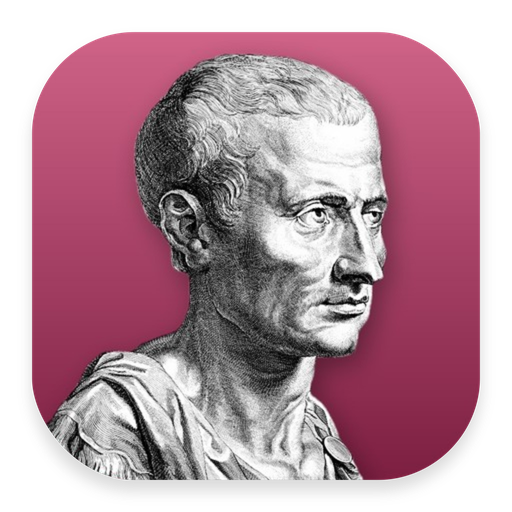
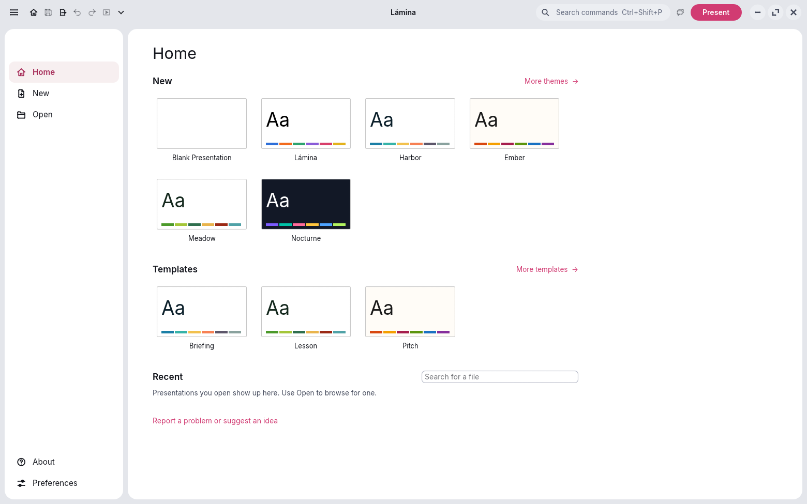

<div align="center">
  <a href="https://getnodalia.com">
    
  </a>
  <br><br>
  
  <h1>Lámina</h1>
  <p><strong>The presentation application of the Nodalia suite.</strong></p>

  <p>
    
    
    
  </p>

  <p>
    <a href="#overview">Overview</a> ·
    <a href="#download">Download</a> ·
    <a href="#build-and-run">Build</a> ·
    <a href="#project-status">Status</a> ·
    <a href="#the-nodalia-suite">Suite</a> ·
    <a href="#license">License</a>
  </p>
</div>

---

## Overview

**Lámina** is the presentation application of [Nodalia](https://getnodalia.com): a native app written in Rust,
with no account and no cloud. It runs on Linux, macOS and Windows, opens and saves `.pptx` by default,
and shares its start screen, Preferences and look with Letra and Celdas, the other Nodalia office apps.

<p align="center">
  
</p>

<table>
  <tr>
    <td width="50%"><br><sub>File › Home, the start screen shared by the office apps</sub></td>
    <td width="50%"><br><sub>Dark mode, with a native chart</sub></td>
  </tr>
</table>

- **Full presentations:** slides and sections, masters, shapes, text, tables, charts, pictures, audio and video, transitions and animations.
- **`.pptx` first:** opens and saves PowerPoint files by default, and exports to PDF, images and the web.
- **Present:** Presenter View with notes, a timer and the next slide; rehearsed timings and custom shows.
- **Nodalia Design:** rounded islands, bold icons, light and dark themes, and Nodalia's own window controls on Linux.
- **Agent control:** every action is a command, reachable from the command line, the control channel and MCP.

> [!IMPORTANT]
> **Lámina is at an early stage.** Keep copies of important presentations and report what breaks in
> [Issues](https://github.com/getnodalia/lamina/issues).

## Download

Installers for Linux (AppImage, `.deb`, `.rpm`), macOS (DMG) and Windows (`.msi`) are on the
[Releases](https://github.com/getnodalia/lamina/releases/latest) page and at
[getnodalia.com/lamina](https://getnodalia.com/lamina). Lámina updates itself from inside the app.

The macOS package is not signed: the first time, open Lámina with right-click › Open.

## Build and run

You need a recent stable Rust toolchain.

```bash
git clone https://github.com/getnodalia/lamina.git
cd lamina
cargo run --release -p lamina
```

## Project status

| Area | State |
|---|---|
| Package and binary names | Done: Lámina everywhere |
| App icon | Done: portrait of Cicero |
| Nodalia interface | Done: NDL islands, icons, window controls, global menu on Linux |
| Shared office resources | Done: File view, Home and Preferences shared with Letra and Celdas (nodalia-design) |
| Installable packages | Linux, macOS and Windows, released automatically |

## App icon

Nodalia app icons are black-and-white portraits of historical figures over the app colour.
Lámina's is Cicero, the great orator. Provenance and licence are in [`assets/app-icon/`](assets/app-icon/).

## The Nodalia suite

Lámina is one of the applications of [Nodalia](https://getnodalia.com), an independent software
project developed in public by [Daniel Miguel Tejedor](https://danielmigueltejedor.com).

## License

`MIT OR Apache-2.0`. See [`LICENSE-MIT`](LICENSE-MIT), [`LICENSE-APACHE`](LICENSE-APACHE) and
[`NOTICE`](NOTICE).
